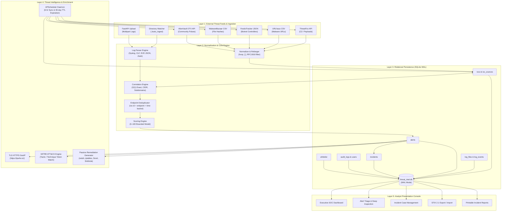

# SENTINEL // System Architecture

## 1. Architectural Blueprint

The architecture of SENTINEL is organized into five decoupled operational layers:

---

## 2. Component Specifications

### 2.1 Threat Ingestion & Normalization (`app/normalizer.py`, `app/collectors/`)
- **Refanging:** Translates obfuscated syntax into valid URIs (`hxxp://` $\rightarrow$ `http://`, `evil[.]com` $\rightarrow$ `evil.com`, `user[at]phish{.}net` $\rightarrow$ `user@phish.net`).
- **Indicator Validation:**
  - IPv4 / IPv6: Validated via Python's standard `ipaddress` library.
  - CIDR: Normalized and indexed as `ipaddress.ip_network(val, strict=False)`.
  - Domains: Label-validated (1–63 chars/label, valid TLDs, lowercased).
  - URLs: Preserves case-sensitive paths, query strings, and strips HTML fragments.
  - Hashes: Validated against strict hex representations (MD5: 32, SHA1: 40, SHA256: 64).
- **RFC1918 Handling:** Private internal subnets (`10.0.0.0/8`, `172.16.0.0/12`, `192.168.0.0/16`) and loopback addresses are strictly discarded when parsing external threat intelligence feeds, but retained when parsing internal security logs.

### 2.2 Correlation Engine (`app/correlator.py`)
- **Exact Matching ($O(1)$):** Active indicators are indexed into an in-memory dictionary on initialization, enabling sub-15-microsecond lookups per artifact.
- **CIDR Subnet Matching:** Evaluates extracted log IPs against all active malicious subnet blocks.
- **DNS Label-Boundary Matching:** Evaluates domains while enforcing dot-boundary hierarchy (`sub.evil.com` matches `evil.com`, but `notevil.com` does not).
- **Asset-Aware Deduplication:** Aggregates repeated hits using the deterministic key:
  $$\text{dedupe\_str} = \text{f"ioc-\{ioc.id\}-ep-\{endpoint\}-bucket-\{time\_bucket\}"}$$
  where `endpoint` is the source host IP identified from firewall `SRC=`, JSON `src_ip`, or private internal IP artifacts.

### 2.3 Threat Scoring Engine (`app/scoring.py`)
Computes an explainable risk score bounded between 0 and 100:
$$\text{Score} = \min\left(100, \left\lfloor S_{\text{base}} \times M_{\text{feed}} \times M_{\text{type}} \right\rfloor + B_{\text{hits}}\right)$$
- Base Score: IOC Confidence rating (0–100).
- Corroboration Multiplier ($M_{\text{feed}}$): Multi-feed agreement boost ($1.0\times$ for 1 feed, $1.2\times$ for 2 feeds, $1.35\times$ for $3+$ feeds).
- High-Fidelity Type Multiplier ($M_{\text{type}}$): SHA256 ($1.15\times$), URL ($1.1\times$), Domain/IPv4 ($1.0\times$).
- Occurrence Bonus ($B_{\text{hits}}$): Repeated log beaconing bonus (up to $+15$ points).

### 2.4 Persistence & Concurrency (`app/database.py`)
- SQLite 3 configured with Write-Ahead Logging (`PRAGMA journal_mode=WAL`).
- Normal synchronization (`PRAGMA synchronous=NORMAL`).
- 15,000 ms busy timeout (`PRAGMA busy_timeout=15000`) enabling concurrent web interface browsing during high-volume background log ingestion.

